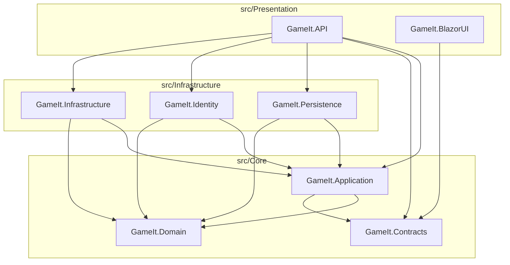

Last updated: 2026-10-29

# 02 — Target System Architecture & Solution Structure Blueprint

## 1. Enterprise Repository & Solution Structure Blueprint

The repository is flattened from the nested `GameIt/GameIt.Api/` wrapper so the git root (`D:\Projects\GameIt`) directly hosts `.github/workflows/`, `Directory.Build.props`, `GameIt.sln`, `src/`, and `tests/`.

```text
GameIt/                                      # True Git Root
├── .github/workflows/                       # CI/CD workflows at true root
├── Directory.Build.props                    # Centralized TargetFramework, Nullable, ImplicitUsings
├── GameIt.sln                               # Root Solution with Solution Folders (Core, Infrastructure, Presentation, Tests)
├── docs/                                    # Architecture, DB, API, UI/UX, Testing, Deployment, ADRs
├── src/
│   ├── Core/
│   │   ├── GameIt.Domain/                   # Pure Domain Entities & Enums (zero framework dependencies)
│   │   ├── GameIt.Application/              # CQRS Handlers, Validators, Repository & Service Interfaces
│   │   └── GameIt.Contracts/                # Shared DTOs, Requests, Responses & Enums (API <-> BlazorUI)
│   ├── Infrastructure/
│   │   ├── GameIt.Persistence/              # GameItDbContext, EntityConfigurations, Repositories, UnitOfWork
│   │   ├── GameIt.Identity/                 # GameItIdentityDbContext, ApplicationUser, AuthService, UserService
│   │   └── GameIt.Infrastructure/           # StripeService, EmailSender, Hangfire Jobs, LoggerAdapter
│   └── Presentation/
│       ├── GameIt.API/                      # ASP.NET Core Web API Controllers, Middleware, Program.cs
│       └── GameIt.BlazorUI/                 # Standalone Blazor WebAssembly (Core -> Shared -> Features)
└── tests/
    ├── GameIt.Application.UnitTests/        # xUnit + Moq + Shouldly CQRS Handler & Validator tests
    └── GameIt.Persistence.IntegrationTests/ # EF Core DbContext & Repository integration tests
```

## 2. Clean Architecture Dependency Graph



### Dependency Rules
1. **`GameIt.Domain`** has **zero** project references and **zero** NuGet framework dependencies (`Microsoft.AspNetCore.Identity.EntityFrameworkCore` removed).
2. **`GameIt.Contracts`** has **zero** project references and contains pure serializable C# `record` / `class` DTOs, Request/Response contracts, and shared enums (`PaymentStatusDto`).
3. **`GameIt.BlazorUI`** references **only** `GameIt.Contracts` — never `GameIt.Application` or `GameIt.Domain`.
4. **`GameIt.Persistence`** and **`GameIt.Identity`** do not reference each other; both implement interfaces defined in `GameIt.Application`.

## 3. Clean `GameIt.BlazorUI` Internal Folder Blueprint (`Core -> Shared -> Features`)

```text
src/Presentation/GameIt.BlazorUI/
├── Core/
│   ├── Authentication/
│   │   ├── CustomAuthStateProvider.cs       # UTC-safe JWT parsing, role claims extraction, state notification
│   │   └── JwtAuthorizationMessageHandler.cs# DelegatingHandler automatically attaching Bearer token
│   ├── Http/
│   │   ├── ApiResult.cs                     # Unified result wrapper (Data, Success, Message, ValidationErrors)
│   │   └── ProblemDetailsParser.cs          # Parses RFC 7807 CustomProblemDetails & FluentValidation dictionaries
│   ├── Layout/
│   │   ├── MainLayout.razor                 # App shell with Sidebar, TopBar, ErrorBoundary, ToastContainer, ModalHost
│   │   ├── AuthLayout.razor                 # Focused split-panel dark storefront layout for Login/Register
│   │   ├── Sidebar.razor                    # Role-aware navigation (Storefront, Deals, Library, Wishlist, Purchases, Admin)
│   │   └── TopBar.razor                     # Global search, active role badge, Wishlist/Library quick links, user profile
│   └── Services/
│       ├── ToastService.cs                  # Non-blocking toast notification state
│       └── ModalService.cs                  # Programmatic confirmation & slide-over drawer orchestration
├── Shared/
│   └── UI/
│       ├── PageHeader.razor                 # Title, subtitle, breadcrumbs, action slot
│       ├── KpiCard.razor                    # Metric title, tabular-nums value, trend badge, icon
│       ├── DataGrid.razor                   # Generic enterprise table with search, sort, pagination, action column
│       ├── Modal.razor                      # Accessible dialog with backdrop & Escape key handling
│       ├── SlideOverDrawer.razor            # Right-hand slide-over form drawer for Admin Create/Edit
│       ├── EmptyState.razor                 # Icon, heading, description, primary CTA button
│       ├── SkeletonLoader.razor             # Geometry-matched shimmer placeholders (Card, Grid, Table, Detail)
│       ├── StatusBadge.razor                # Semantic pill badge (Succeeded, Pending, Failed, Free, Discount %)
│       ├── ConfirmDialog.razor              # Destructive action confirmation modal
│       └── ToastContainer.razor             # Top-right stacked toast renderer
├── Features/
│   ├── Auth/
│   │   ├── Pages/                           # Login.razor, Register.razor, Logout.razor
│   │   └── Services/                        # IAuthApiClient, AuthApiClient
│   ├── Catalog/
│   │   ├── Pages/                           # StoreHome.razor (/), CatalogPage.razor (/games), GameDetailsPage.razor (/games/details/{Id:guid}), DealsPage.razor (/deals), CategoriesPage.razor (/categories), CategoryDetailsPage.razor (/categories/{Id:guid})
│   │   ├── Components/                      # GameCard.razor, FeaturedHero.razor, ReviewSection.razor
│   │   └── Services/                        # IGameApiClient, ICategoryApiClient, IDiscountApiClient, IReviewApiClient
│   ├── CartAndCheckout/
│   │   ├── Pages/                           # CheckoutPage.razor (/checkout/{GameId:guid}), CheckoutSuccessPage.razor (/checkout/success), CheckoutCancelPage.razor (/checkout/cancel), PurchasesPage.razor (/purchases)
│   │   └── Services/                        # IPurchaseApiClient
│   ├── Library/
│   │   ├── Pages/                           # LibraryPage.razor (/library), WishlistPage.razor (/wishlist)
│   │   └── Services/                        # ILibraryApiClient, IWishlistApiClient
│   └── Admin/
│       ├── Pages/                           # AdminDashboardPage.razor (/admin), AdminGamesPage.razor (/admin/games), AdminCategoriesPage.razor (/admin/categories), AdminDiscountsPage.razor (/admin/discounts)
│       └── Components/                      # GameFormDrawer.razor, CategoryFormModal.razor, DiscountFormModal.razor
└── wwwroot/
    ├── css/
    │   ├── tokens.css                       # 3-tier CSS custom properties (Primitive -> Semantic -> Component)
    │   └── app.css                          # Enterprise Dark Storefront & SaaS utility/component styles
    └── index.html                           # Inter & JetBrains Mono fonts, dark canvas bootstrap
```
